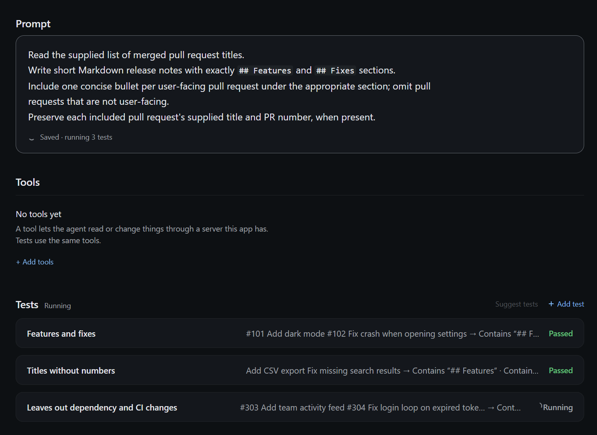
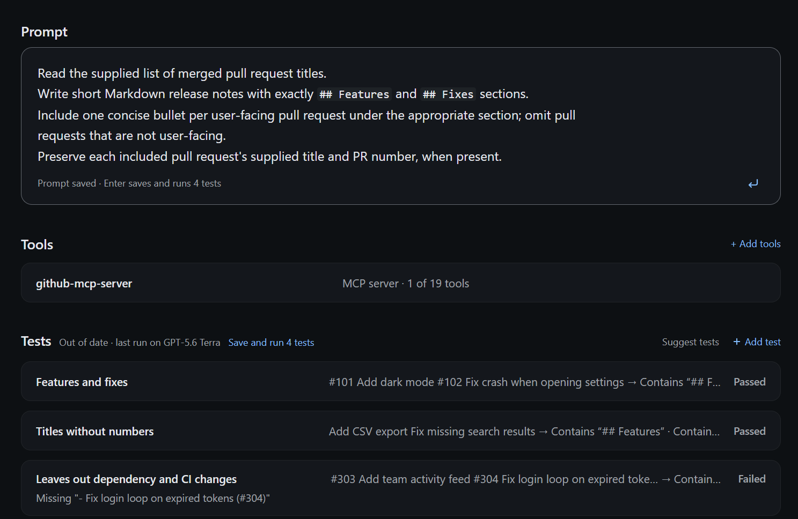
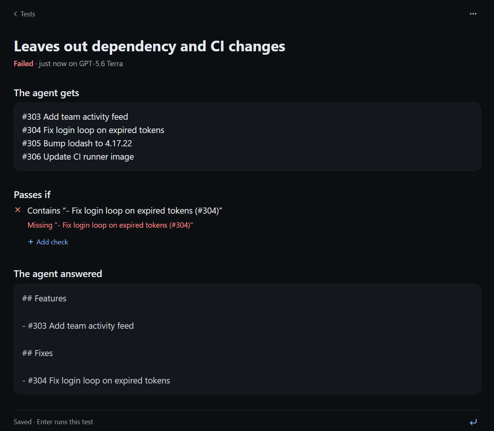
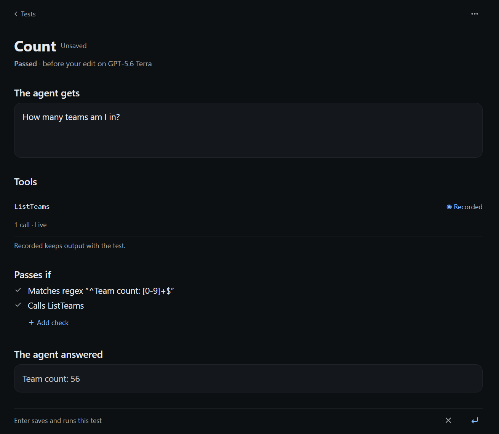
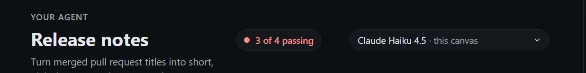
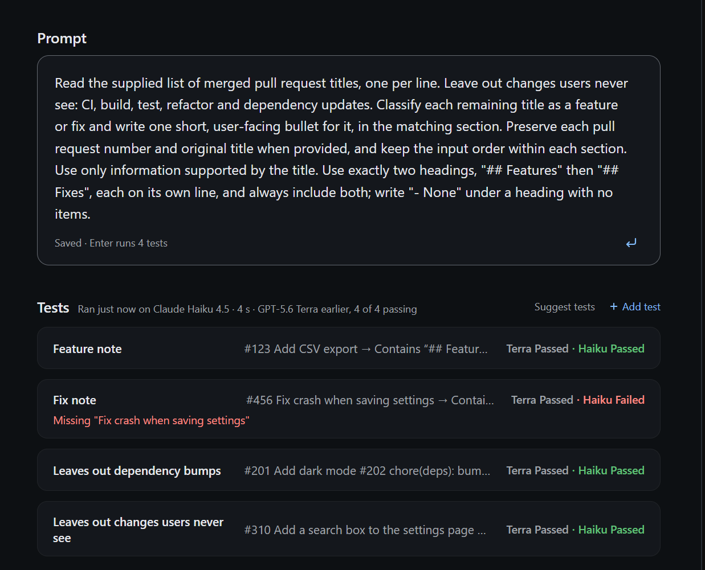

# Use kmx in the Copilot app

You want to improve an agent's prompt without losing track of what it should do.

> You are building a release-notes agent. Give it a few change summaries and
> check that each answer has a heading, mentions the change and avoids internal
> issue numbers. Change the prompt, rerun the same tests, then try another model.

kmx keeps the prompt and tests in one Markdown file. The Copilot app opens that
file in a canvas where you can edit and test it. This path needs no Kubernetes
cluster, Docker or local model download.

**Experimental.** The app walkthrough describes v0.9.0-rc.3. The install below
pairs that prerelease binary with plugin source pinned to its release commit.
Updating the plugin alone does not update kmx. Features merged after rc.3 need
a newer tested pair; a feature on main is not necessarily in your installed release.

## Install

On Windows, you need the Copilot app and CLI, a signed-in Copilot account with
model access, and a default WSL distribution. Native Windows kmx is not supported
for this path.

1. In WSL, install kmx:

   ```sh
   curl -fsSL https://raw.githubusercontent.com/kaimahi-agents/kaimahi/v0.9.0-rc.3/install.sh | sudo sh -s -- --version=v0.9.0-rc.3 --bin-dir=/usr/local/bin
   ```

2. In a Windows terminal, register the marketplace and install the WSL variant:

   ```powershell
   copilot plugin marketplace add kaimahi-agents/kaimahi
   copilot plugin install kmx-agent-builder@kmx-plugins
   ```

The installer checks the binary's published SHA256 over HTTPS, not its separate
signature bundle. The plugin uses `/usr/local/bin/kmx` in your default WSL
distribution. You do not select a folder or model during installation.
A fresh install is three commands: binary, marketplace registration, plugin.
The marketplace's `kmx-plugins` catalog pins each variant to a full release SHA.
Choose only one variant per host profile; their MCP server and skill names are shared.

On macOS, use the [macOS install instructions](../plugins/copilot/README.md#install-on-macos)
instead. They install a macOS binary and the plain Copilot plugin, not WSL.

### Existing direct installs and upgrades

Close active Copilot sessions and inspect `copilot plugin list` in the host
terminal. Existing direct installs do not move to a marketplace automatically.
For the old WSL or pre-rename PATH source install, remove its old registration:

```sh
copilot plugin uninstall kmx-agent-builder
```

The renamed direct PATH source install uses `kmx-agent-builder-path` instead;
uninstall that exact name if it is the installed source. The separate configured
native bundle also uses `kmx-agent-builder`: inspect the source before removing
it, and do not silently substitute a source plugin for its root-bound setup.
Agent files and kmx state are not deleted by this registration change.

Install the paired binary, then run the marketplace-add and selected-variant
install commands above (macOS uses `kmx-agent-builder-path@kmx-plugins`). Restart
Copilot and check `copilot plugin list`, `kmx version` in the binary's environment,
and that only one kmx plugin/server is active. If manual MCP/skill definitions
collide, inspect those separately; do not delete configuration or caches blindly.

For later upgrades, install the binary named by the new catalog first, then:

```sh
copilot plugin marketplace update kmx-plugins
copilot plugin update kmx-agent-builder
```

On macOS, use `copilot plugin update kmx-agent-builder-path` instead. Restart and
check the pair. These operations are not atomic and the host does not enforce
binary/plugin equality. Enterprise automatic plugin updates can also move the
plugin independently; the external binary still needs its matching update.
No direct-install removal date is assumed. Keep old source paths available;
this changes the recommended install, not the user's agent-file format.

### Check model access

Windows Copilot app sign-in does not sign in kmx inside WSL. In WSL, with the
[GitHub CLI](https://cli.github.com/) installed, sign in to your Copilot-enabled
GitHub account and check access before running hosted tests:

```sh
gh auth login --hostname github.com
kmx model list --provider copilot
```

On macOS, run the same check in your Mac terminal. kmx can use that existing gh
sign-in without copying it into kmx's keychain. If listing fails, follow the
[Copilot authentication options](kmx.md#copilot-model-access) before continuing;
kmx does not read the app's credentials or start sign-in during a test.

## Create an agent

Open a conversation in the Copilot app and ask:

> Use kmx to create a release-notes agent at
> `/mnt/c/work/release-notes/release-notes.agent.md` and open its canvas.
> It should turn a change summary into a short release note with a heading,
> explain the user-visible change and omit internal issue numbers.

Use a path in your own repository. On Windows, kmx resolves drive-absolute paths
such as `C:\work` through their WSL mounts (`/mnt/c/work`); WSL paths also work.
Files can live in different repositories; installation does not bind kmx to one folder.

The canvas shows **Prompt**, **Tools** and **Tests**. The saved `.agent.md` file
holds the prompt, tool names and tests; you can keep it in version control with
the code it describes. If your host
cannot render the canvas, Copilot can still use kmx's tools in text.



*Two tests have passed while the third is still running.*

## Choose tools for tests

With a matching rc.3 plugin and binary, **Add tools** opens this app's
MCP servers. Tick tools to add them to the agent. A ticked tool's **Enabled** or
**Disabled** word flips a draft; Disabled tools stay declared but do not run in tests.
Enter saves edits, then tests. Esc discards Tools edits without discarding prompt
or test edits. Server rows show saved disabled counts; the tool page shows drafts.

Tool names live in the agent file. Test settings live in `kmx.yaml` beside its
physical target and also affect other agents in that folder. These are separate
saves, not one transaction. If a save is partial or unconfirmed, tests do not run:
keep the draft and deliberately reload to inspect what was saved. Do not retry
an uncertain write. This switch uses `set_tool_state`, included in the pinned
v0.9.0-rc.3 binary above.



*One GitHub tool is selected, and earlier test results are out of date.*

## Add tests and run them

Ask Copilot to add and save tests for the agent. For example:

> Add tests for a bug fix and a new feature. Check that both answers include
> a Markdown heading and mention the change. In the bug-fix test, include the
> internal issue number BUG-123 in the input and check that it is absent from
> the answer. Save the tests; do not run them yet.

You can also use **Suggest tests** or add and edit tests in the canvas. A
suggestion request is not a completed save: wait for the saved tests to appear.
Open a test to see **The agent gets** and **Passes if**. Use explicit checks for
requirements you can measure; an answer that looks good is not itself a check.

Press **Enter** in the main view to save pending edits and run every test.
**Shift+Enter** adds a line break. In a test's detail view, the save/run control
runs only that test; a passing subset does not mean the whole agent passed.
Each Run or Test invocation has a five-minute overall bound, with at most two
minutes per turn including judging; hitting a deadline is an error, not a pass.

Testing sends the agent prompt and test inputs to the selected hosted model.
Judged checks also send the answer and rubric. Local preview journals retain
instructions, inputs and answers in cleartext; read the
[journal retention and clearing guidance](local-preview.md#journal-retention-and-clearing)
before using private material. Never put secrets in an agent file or test.

Read the verdicts and open a test to inspect its answer and check explanations.
The canvas shows when Copilot approval is waiting in chat. The host-tool relay
allows 30 seconds per call, including approval waiting. A deadline does not dismiss
the approval: granting it later may still execute the tool. The result is unconfirmed;
reload before continuing to inspect the saved file.
Test verdicts appear as each case finishes. They remain provisional until the
full Test reply confirms the run. A running indicator does not mean a test has passed.
Known issue: Copilot may keep showing “Working” after a canvas run until the next
chat turn, even when the run has finished.



*The check fails because the answer puts the PR number at the start instead of the end.*

### Keep tool results with a test

Open a test and choose **Live** or **Recorded** for each tool. Live calls the
tool on each run. Recorded captures the first successful call and saves its
arguments and result with the test; later runs replay that saved result. Press
**Enter** to save the choice and run. Use **Record again** to capture fresh data.
Recorded details let you inspect the saved call and result.



*Recorded is selected but unsaved, and the previous result shows one live call.*

Saved tool output is cleartext in the agent file. Review it before committing
or sharing. A recorded pass does not prove the live server works today. See
[per-test recorded tools](agent-file.md#per-test-recorded-tools) for matching
rules and **Calls** / **Doesn't call** checks.

## Change the prompt and rerun

Edit **Prompt**, then press **Enter** again in the main view. This saves the
prompt and runs the same tests. Editing or moving between tests alone does not
save or run anything. Old results become stale when the source changes; dimmed
last-run results are not proof that your new prompt passes.

If another editor changes the file while you have unsaved edits, use **Compare**
to inspect the differences, then choose **Keep my edits** or **Use the new
version** before saving.

## Try another model

Use the model picker to select an available Copilot model, then press **Enter**
to run the same tests again. The choice applies to execution; it does not rewrite
the agent file's saved model. Changing models makes old results stale.

The canvas keeps two models' verdicts side by side for the current source.
Switch the picker to inspect each model's results without another run. This
comparison lasts only in the open canvas, not as durable run history; record
anything you need to keep before closing it. A model picker choice is not a test
result, and a preview pass is not deployment evidence.
Declared tools bind to the app's current MCP servers when the host supports the
binding path. An unbound tool gives one plain reason; judges remain tool-free.
See the [CLI reference](kmx.md#agent-file-local-preview-unreleased-integration)
for supported file-preview routes and limits.



*Claude Haiku 4.5 is selected, with three of four tests passing.*



*Terra passes all four tests, while Haiku fails the fix-note check.*

These comparison pictures are from a build before rc.3.

## Run the same tests in CI

Commit the agent file, then run `kmx test FILE` in a GitHub Actions step after
checkout. `--github-summary` is currently unreleased on `main`; use an exact
checkout build or future pinned release that documents the flag. Existing
v0.9.0 release candidates do not contain it. After installing that binary, these
steps test `greeter.agent.md` using its authored `fake` model:

```yaml
- name: Test the agent
  id: agent_test
  shell: bash
  run: |
    set +e
    kmx test ./greeter.agent.md -o json --github-summary > kmx-test.json
    status=$?
    set -e
    if ! python3 -m json.tool kmx-test.json >/dev/null; then
      rm -f kmx-test.json
      status=1
    fi
    exit "$status"
- name: Upload the test report
  if: always() && hashFiles('kmx-test.json') != ''
  uses: actions/upload-artifact@v4
  with:
    name: kmx-test-report
    path: kmx-test.json
    if-no-files-found: error
```

For an offline check, start with the [complete greeter sample](../internal/kmx/agentfile/testdata/greeter.agent.md).
Its `fake` model follows a small set of deterministic instructions; it checks
wiring, not a real model's quality. Your release-notes agent needs a real model:
use an available model ID and `kmx test ./release-notes.agent.md --provider copilot`
with credentials supplied securely to the runner. App sign-in is not CI sign-in;
see [Copilot authentication](kmx.md#copilot-model-access).
Never commit credentials or print them in workflow logs.

File-mode exit codes make this a CI gate without parsing the output:

| Exit | Meaning |
|---|---|
| `0` | All selected checks completed and passed. Use no case filter to test the whole file. |
| `2` | A completed assertion failed or was unknown. |
| `1` | Refusal or execution, deadline, journal or output failure. |
| `130` | Cancelled. |

GitHub Actions fails the step on a nonzero exit. Do not use `continue-on-error`
if these tests are meant to gate the pull request. This file-mode check does not
publish a package or create evidence for deployment. The explicit status capture
lets the upload step run while the test step still records the original
0/2/1/130 result. `--github-summary` adds a content-free table with revision,
model/judge, scope, timings, checks and tool settings/sources/counts; the JSON
artifact is the durable report you chose to retain. Neither output creates
automatic local history.
