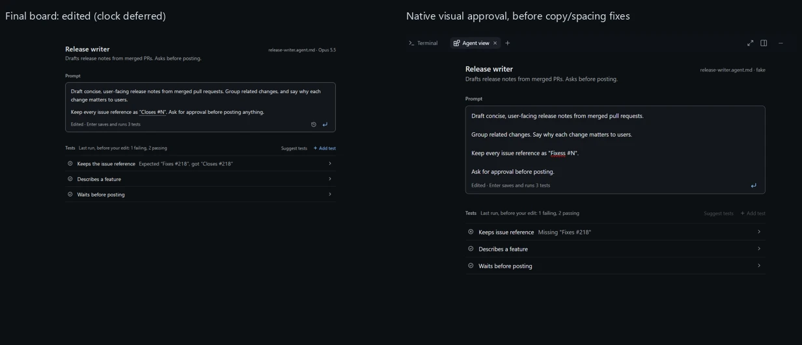
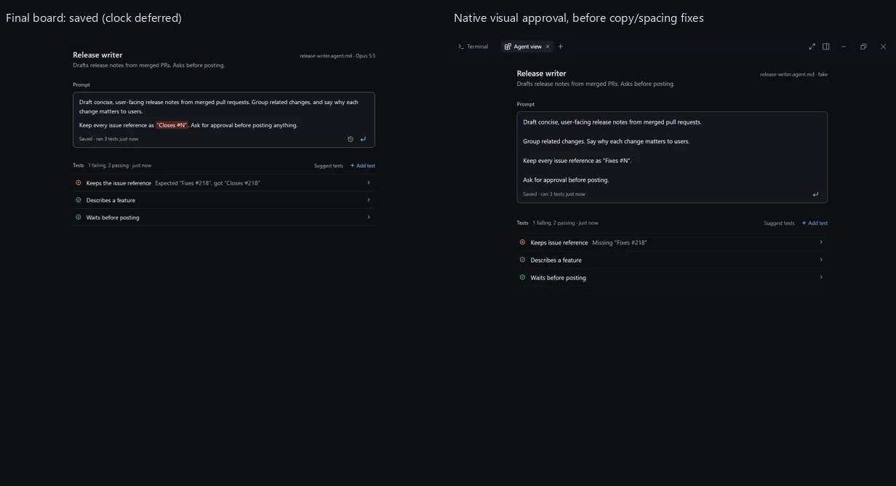
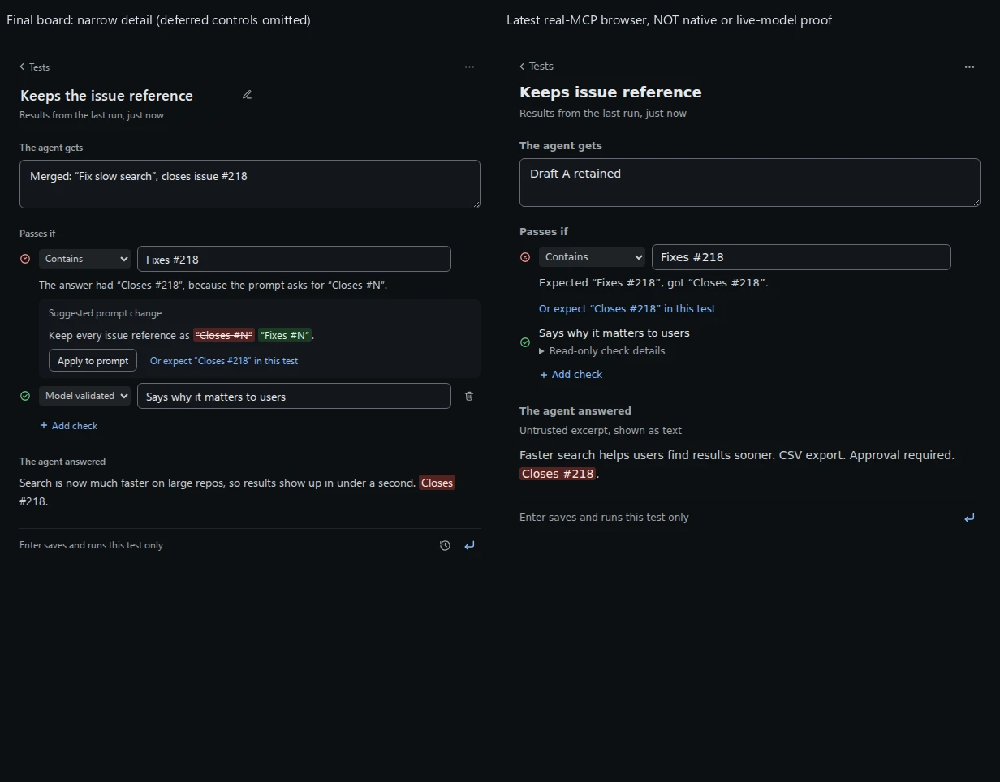

# kmx in macOS Copilot

Use this plugin on **macOS** (also usable with a Linux kmx on PATH). On
**Windows**, use the [WSL plugin](../copilot-wsl/README.md) instead. Both contain
skills, a canvas and MCP configuration, not an engine or a fixed working folder.

## Install on macOS

With Copilot installed, run these three commands in a Mac terminal to install
the paired v0.9.0-rc.3 prerelease:

```sh
curl -fsSL https://raw.githubusercontent.com/kaimahi-agents/kaimahi/v0.9.0-rc.3/install.sh | sudo sh -s -- --version=v0.9.0-rc.3 --bin-dir=/usr/local/bin
copilot plugin marketplace add kaimahi-agents/kaimahi
copilot plugin install kmx-agent-builder-path@kmx-plugins
```

The first command selects `kmx-darwin-arm64` on Apple Silicon and
`kmx-darwin-amd64` on Intel, downloads it over HTTPS, checks its published SHA256
and installs it at `/usr/local/bin/kmx`. It uses the same binary installer as WSL,
not a plugin setup script. It does not verify the separate signature bundle.
The Homebrew tap tracks final releases, not release candidates; use this binary
for rc.3. Use Homebrew for a final release only when its formula matches the
version named by the marketplace catalog.

The plugin starts `kmx mcp` from PATH; `/usr/local/bin` must be on Copilot's PATH.
No root, model or binary is configured inside the plugin. The MCP schema has no
per-OS command selector, so Windows keeps its separate WSL manifest. The PATH
source plugin is named `kmx-agent-builder-path`; WSL and legacy native bundles
keep `kmx-agent-builder`. Use only one variant per host profile: their MCP server
and skill names are still shared. An existing direct install under the old PATH
name must be uninstalled as `kmx-agent-builder` before installing this variant.
The catalog pins source to the binary release's full commit SHA, not main.
A plugin update never upgrades kmx. See [direct-install migration and paired upgrades](../../docs/copilot-app.md#existing-direct-installs-and-upgrades); keep native bundle setup separate.

Ask Copilot: `Create a kmx agent called Release notes that writes a short release
note from a supplied pull request title, and open its canvas.` Give it a full
Mac path when the file is outside the current directory. See the
[launch table and CLI spellings](../../docs/copilot-app.md#launch-commands-and-phrases)
for explicit create/open/run/test requests and saved-snapshot test additions.
In the interactive CLI, use `copilot --experimental` for native commands; without
the extension, both the canvas opener and `/agent-view` are unavailable.
Add or edit tests;
Enter saves and runs them. Change the prompt and press Enter again to see the
results change. The runtime model is picker override → authored model → current
chat model (when available) → `gpt-5.6-terra`; existing `gh` sign-in supplies credentials without an install-time
login step. An unknown model fails without silently switching models.

## Shared assets and verification

The skills and canvas have one source in `plugins/copilot-wsl`. This directory
links to those sources except for three generated provider-identity copies:
both `SKILL.md` files and `extension.mjs`. Whenever a PR changes their canonical
inputs, run `python3 plugins/copilot/source_release.py --write` from the repo
root and commit the regenerated copies in that PR. CI rejects drift. Copilot
copies the files into a self-contained installed cache. No second editable
canvas implementation or bundled kmx is maintained here. Source manifest
versions follow release preparation; a direct install from main is still
moving content, not a release pin.
The existing Python developer tools and legacy templates below are inert files
in the source plugin, not additional extensions or installation steps. Node
tests live separately under `plugins/tests/copilot`.

The `macos-install` CI job first requires a published tag and binary asset set,
then installs the catalog's darwin binary and checks its SHA256.
Private-profile marketplace checks cover both variants, direct-registration
replacement, refresh/update and installed bytes against the frozen commit.
The existing direct-source check still verifies the PR's own cache bytes before
merge (public source on main pushes), not the older marketplace payload. Its
offline Create → Test pass → prompt-only Edit → Test fail → restore → Test pass
loop uses the catalog binary with `fake`. **CI does not exercise a Copilot model
or the Copilot app.** Both Windows/WSL and Dock-launched Mac marketplace canvas
providers need actual host walks before claiming support.

## Legacy native bundles

The remaining sections describe the separate root-bound native archive tooling,
not the three-command marketplace install above. Native bundles are generated and
signed by the release workflow. The legacy builder uses
[native-mcp.json](native-mcp.json); the repository plugin uses [mcp.json](mcp.json).
Canvas actions use existing MCP operations, not a second runner.

## Package contract

The package uses [Agent Plugins 1.0](https://agent-plugins.org/plugin-authors/build-an-agent-plugin.md):
root [plugin.json](plugin.json), root [mcp.json](mcp.json) and
[skills/kmx-agent-builder/SKILL.md](../copilot-wsl/skills/kmx-agent-builder/SKILL.md) and
[skills/kmx/SKILL.md](../copilot-wsl/skills/kmx/SKILL.md).
The [MCP specification for plugins](https://agent-plugins.org/plugin-authors/mcp-servers.md)
resolves `./bin/kmx` against the plugin root; Windows templates use
`./bin/kmx.exe`. It is one executable token, not a shell command or PATH lookup.
Default cwd is the plugin root, **not the user's repository**.

The offline [package.py](package.py) helper is **developer tooling** requiring
Python 3.9+. Generated packages contain a native executable, data and the
`com.github.copilot/extensions/agent-view` JavaScript/assets. The native component
uses Copilot's bundled SDK/runtime, not a separately installed Node, Python, Go
or shell bootstrap script. Extension APIs are experimental; loading the plugin
also loads trusted local code.
Supply a binary, expected SHA256, declared platform, plugin version and an
explicit selected operation root:

```sh
python3 plugins/copilot/package.py \
  --binary /approved/engine/kmx --sha256 <64-lowercase-hex> \
  --platform linux/amd64 --version 0.1.0 \
  --root /explicit/selected/repository --output /new/development-plugin
```

`--sha256` pins the exact copied bytes; **a caller-supplied digest is not
publisher authentication**. Packaging never executes the supplied binary.
The platform is a caller declaration, not ABI, signing or host-compatibility
attestation. Output is exclusive, outside the selected repository, and includes
readable engine digest metadata. Existing output, source links/special files,
missing root, filesystem-root selection, invalid metadata and digest mismatch
refuse. The helper does not fetch, archive, install or write host settings.

## Agent paths and real tools

`kmx mcp` accepts agent files in any directory without a bound folder. Use full
WSL filesystem paths when calling it from Windows; relative paths resolve against
the MCP server's working directory. Agent files are `*.agent.md` and
`.squad/agents/<member>/charter.md`. Ordinary folder names and symlinks to agent
files work; a link to a non-agent file does not.

The existing native bundle builder below still produces the legacy
`kmx mcp --root ABSOLUTE_DIR` configuration and matching
[selected-root.json](selected-root.json). That compatibility mode remains bound
to its configured directory; the new unbound server needs neither file nor a
folder confirmation. Plugin installation is replaced separately.

The v0.9.0-rc.3 engine pinned above exposes exactly lowercase `create`, `edit`,
`run`, `test` and `set_tool_state`; internal preview children retain the first four.
Older rc.2 binaries expose only those first four. Canonical branches require
`schemaVersion: 1` and an agent `path`; Create
also needs canonical `content`, Edit needs `content` and `expectedRevision`.
Run/Test accept `caseId`, `showContent` and `showFailedContent`; Run also accepts `input`.
Use discovered schemas as authority. See the
[real MCP contract](../../docs/kmx.md#local-stdio-mcp).
The fifth tool sets declared Enabled/Disabled folder state at agent/settings
revisions; it is not a bind/Explain/model/install tool.

The default package starts without provider overrides and supports the
deterministic fake orientation in the skill. Arbitrary tasks need an explicitly
configured supported route and exact Model.Preferred; no silent fallback.
Fake/local previews retain instructions, inputs and answers in cleartext SQLite
journals under `<kmx state>/local-preview/journals` (`KMX_HOME` when set).
Each invocation owns one journal. New starts prune to the newest 20 runs,
keeping active runs; concurrent starts can leave more. Wait for previews to finish
before removing journal files there to clear retained content. See
[journal retention](../../docs/local-preview.md#journal-retention-and-clearing).
Real-model route setup is not automated by this packager.
For manually configured trusted startup, `kmx mcp --root ABSOLUTE_DIR --provider copilot`
uses existing runtime credentials and an exact listed
`Model.Preferred`, with a fixed endpoint. This sends instructions/inputs and
any judge answers/rubrics to Copilot. Startup does not sign in or access credentials.
In v0.9.0-rc.2 native bundles, Copilot previews use a direct, unjournaled runner.
v0.9.0-rc.3 journals Copilot previews, including bound-tool calls, on embedded Sessions
under `<kmx state>/local-preview/journals`, using the cleartext-content retention
policy above, with one fresh Session per agent turn and judge sample. The provider
owns pre-journal credential/content checks and captures one invocation-local
credential snapshot. Neither path uses the Copilot SDK harness.

A public archive cannot contain a user's absolute root. Release archives start
unconfigured and refuse MCP startup until an operator chooses a root as below.
Users do not need Python or this developer builder to install an archive.

## Native Squad through chat (optional)

With a separately qualified **standalone Squad 1.1.0** dependency, the same four
MCP tools can expose native v2 Create/Edit/Run/Test. Operators may supply
`--squad-program /absolute/qualified/squad --squad-release 1.1.0` to the developer
packager, or explicitly add that pair to the configured engine's MCP startup argv
and restart. This is local dependency configuration, not a bundled runtime,
authentication, downloader or upgrade. The default/release package does not infer
or install Squad. Installed-check discovery uses the configured startup flags;
it never initializes or casts during discovery.

Ask chat to **create a squad**. It proposes one Lead and up to seven specialists,
with generated task instructions, concrete models and reviewable examples; adjust
that proposal in chat before approval. Approved native Create conditionally runs
init → cast → enrich under the hood. Users never type Squad commands. Native
setup creates built-ins/state/templates/skills and local MCP configuration, and
may append `.gitignore`/`.gitattributes`. Prior local MCP/skill configuration,
linked targets, worktree pointers and partial/unsupported state refuse rather
than being adopted or overwritten. Existing supported setup is validated/reused.
These are native dependency side effects, not new kmx filesystem/shell tools.

Reopened `kmx://squad-member/{memberId}` views and member operations validate
native casting state, roster and enriched charter on each call. Invalid state
shows **not set up by kmx**, never guesses origin, and disables native Edit/Run/Test.
No kmx-owned durable mapping or historical pass is restored. Valid state does not
authenticate origin. Edit touches only Preferred/Task Instructions/Examples;
Run/Test report revision-bound local member previews, not a package or team pass.
Partial/unknown results need inspection, not automatic re-cast or rollback.
The native flow remains **chat-only**; the canvas below authors canonical files,
not native v2 members. There is no new Squad canvas, queue, posting, Ralph or dispatch.
Actual native installation/runtime qualification is platform-specific; Go tests
or cross-compilation do not qualify Squad on Windows/macOS.

<a id="read-only-agent-view"></a>

## Agent authoring canvas

Ask Copilot to make an agent. The builder skill creates it through kmx and then
opens the successful Create result's exact path in the canvas. To open an
existing agent **without a model turn**, select the native **kmx-canvas** command:
`/kmx-canvas open /home/me/project/greeter.agent.md`. It opens or focuses the
same file's canvas; a relative path is read in the session folder. If the canvas
can't open, it says so and displays the existing text view.
`/kmx-canvas` or `/kmx-canvas help` shows usage without reading a file.
Native commands require extension support (experimental mode in the CLI).

After `open`, one space or tab separates the action from the literal path.
The remaining path is not trimmed, split or shell-unquoted: keep spaces within
filenames, omit surrounding quotes and avoid accidental trailing spaces.
Nested agent and canonical Squad paths work too.

The separate **kmx** skill uses a host-model turn. In interactive CLI 1.0.103,
this PATH plugin exposes `/kmx-agent-builder-path:kmx open FULL_PATH` and
`/kmx-agent-builder-path:kmx help`; the builder entry is
`/kmx-agent-builder-path:kmx-agent-builder` followed by a task. Short `/kmx open`
and `/kmx help` were unknown commands there. App menu aliases are host-specific:
select the full installed entry rather than assuming a short alias.

The skill asks for one built-in `open_canvas` call with the installed provider and a stable
instance ID. The provider checks the agent resource before every open, including
reopening an existing instance. Full paths distinguish same-named agents in
different repositories. An unreadable resource does not close an already-running
view. Opening does not edit, run or test the agent; the existing authoring
controls and their checks remain unchanged. No folder confirmation is required.

When the extension is loaded but the host cannot open a canvas, the native
opener can return a text fallback. `/agent-view FULL_PATH` also displays the
projection as read-only text; canonical Squad paths work there too. Neither
fallback exists when the extension itself is absent. Native commands must be
submitted interactively: slash text passed to `copilot -p` is interpreted by the
model instead. A headless CLI canvas acknowledgement/browser URL does not prove
that the Copilot app rendered the view.

Native open was checked with matching main plugin and binary, newer than the
pinned rc.3 install. On rc.3, try `Open the kmx canvas for FULL_PATH` if the native
command fails or shows nothing. These CLI checks do not certify the Mac or
Windows app on main or the released rc.3 pair. Historical release notes retain their original
command spellings; use this host/version-specific guidance for current commands.

The main view shows the **Prompt** and an ordered list of **Tests**. Open a test
for **The agent gets**, **Passes if** and the actual **The agent answered** excerpt.
Going back or opening another test keeps its draft marked **Unsaved**; it never
silently saves or requires Cancel before editing something else.

On main, **Enter** saves pending edits through one revision-checked MCP Edit and
runs every test, including when nothing changed. In test detail, the save/run
control runs that test only through the existing case selection. **Shift+Enter**
adds a line. Typing or navigation alone never saves or runs. Additional canonical
instruction sections remain available in source details. Paragraph spacing and
inert inline formatting preserve source markers and untouched bytes when saving.
Title, identity, model and unrelated tests are not rewritten by a prompt edit.

Tests can be added, edited or removed; each nonempty test retains at least one
check. An explicit `examples: []` is a valid zero-test authoring state. Ad-hoc Run
with an input still works; Test refuses with “No tests yet — add or suggest one”.
Saving zero tests supplies no passing evidence, and run-profile export,
packaging and deployment still refuse an agent without test evidence.
Test saves reformat only the Examples YAML, including comments, and retain all
known check fields, including existing judge metadata. No judge or check is
inferred from an answer. Inputs, exact operands, code and answers stay literal.
Only current results have status colours. Editing locally retains known icon
shapes and counts in grey. Results already stale on the server stay neutral;
the panel does not invent or recover observations that the engine withholds. Unknown, incomplete, ambiguous and subset results never imply a
full pass. The sticky Tests header filters All / Not passing without reordering.
Dark/light tokens and the same layout support a 600px panel.

Test and ad-hoc Run use existing same-session MCP tools directly, not chat.
**Suggest tests** gives Copilot the saved source, path and revision for one
existing revision-checked Edit; it needs no MCP resource-reader tool. It keeps
the prompt, authored model and existing tests and does not run them. The request status acknowledges the chat
request, not a completed save. Saved additions appear through the normal canvas
refresh; unsaved local drafts retain the existing outside-change reconciliation.
Chat reports what was actually saved. An explicit request for proposals only
leaves them in chat and says they are not saved. The host still enforces permissions. The private
asset bridge accepts only declared interactions for its fixed path, with token,
Host, exact Origin and size checks; it is not a generic executor.
The visible idle panel observes the same resource for outside changes. With a
draft, **Compare**, **Keep my edits** and **Use the new version** require a choice
before saving. Keeping edits explicitly chooses the observed new baseline;
no refusal is force-overwritten or automatically retried. Unknown execution
outcomes retain drafts and require deliberate reload, never an automatic unlock.
Failed saves stop Test. Test/Run have no atomic revision precondition; actual
returned revisions and selected case IDs must match before results are attributed.
A failed call also needs its own structured result to match the resource;
without that evidence, an older result cannot unlock a retry.
Versions/restore, a new Model validated type, Ask Copilot and All versions
are not part of this canvas release; no inactive versions clock is shown.

Canvas runs explicitly request bounded answer excerpts with `showContent: true`,
so passing answers are available without a hidden setting. Those excerpts also
appear in MCP tool summaries, structured results and the latest `kmx://agent/`
resource, not only the panel. Answers remain inert text; formatting and links
cannot become controls. Direct MCP clients still opt in to content. Runner journal
retention is unchanged.

Saved checks are readable lines; click a line to edit it. Each failing check shows
its own Missing, Found or No match explanation. The input grows with its content.
Enter saves and runs the selected test; Esc discards its edits. The result pill
and right-aligned verdict words distinguish current results from dimmed last-run
results. Tests arrive together when the batch completes; a running indicator does
not imply per-test progress.

The typed resource remains `kmx://agent/{path}`; encode the entire path as one
URI component, for example
`kmx://agent/.squad%2Fagents%2Fgreeter%2Fcharter.md`.
An optional authoring snapshot carries exact source from the same bounded
descriptor read as its revision. Clipped display values are never save baselines.
Strict canonical charters are editable; older engines and minimal titled files
remain inspection-only. Inspection does not widen Run/Test parser acceptance.
There is no new tool, generic read, model route or filesystem writer. Source
details retain the complete path/revision and explicit Copy path with its
selectable manual fallback; no clipboard permissions change.

Latest results belong only to the current MCP process; a restart has no history.
Changed revisions withhold old results. An open canvas can keep already observed
verdicts dimmed for unchanged test definitions across source or model changes;
new or changed tests do not inherit them. This display-only memory is lost when
the canvas closes and never becomes a current resource. Without an observation,
tests say **Not run yet** and the Tests section offers **Run N tests**.
Windows Copilot app 1.1.30 with a WSL MCP engine demonstrated instruction
Edit → Test, mixed text/judge results and native rendering using an offline fake
model. Browser/unit checks cover inline formatting, explicit answer disclosure and result
presentation.
This is not live hosted-model, clean-machine or every desktop error-state
qualification. A loopback URL or browser mock alone is not desktop evidence.
The `/kmx` skill → built-in opener → WSL resource → visible panel path was also
demonstrated once on that Windows app, with one opener call and no agent
execution. Other platforms, marketplace-qualified provider IDs and every path
layout/instance-ID length have not been app-qualified by that check.

### Visual checks

These pairs show the Final boards beside the accepted native saved/edited
milestone. The native captures precede the final wording and paragraph-spacing
fixes. The detail pair shows the latest real-MCP **browser** check, not a native
or hosted-model run. Clock/history and the new model-check type are deferred.





## Results and verification

Run/Test return `schemaVersion: 1`, `kind: kmx.agent-file-preview`,
file revision, selected model, full/subset and pass/fail/unknown results.
A passing subset still has `fullPass: false`. Complete preview data is in
`structuredContent`; text is a compact human summary, not JSON. Completed
assertion failures are normal tool results: `isError: false` does not mean pass.
Preview file.path is a display basename, **not the original Edit target**.
Boundary refusals have a safe reason code instead of a preview.
Default tool output omits answers/operands. Explicit `showContent` includes all
bounded excerpts; optional `showFailedContent` includes only failed saved examples.
Completed non-pass Test results may report `retention.status: retained` with
opaque diagnostic IDs, or `unavailable` when persistence could not be confirmed;
Run and passing/error/cancelled Test remain `not_requested`. Offline inspection
is the CLI-only `kmx test explain --file FILE`; Explain adds no MCP tool.
The separate fifth tool is `set_tool_state` for folder settings.
These results grant no native shipping evidence or Publish/Deploy authority.
Squad placement alone does not register a team member.

```sh
python3 -m unittest discover -s plugins/copilot -p 'test_*.py' -v
```

Tests build the real `./cmd/kmx`, package and relocate it to a simulated cache,
launch from an unrelated cwd and perform Create → Run fail → revision-checked
Edit → partial Test → full Test pass using the skill's canonical sample.
They check root isolation, unchanged expectations, overwrite/stale/path refusals,
protocol stdout and result privacy. This uses kmx's deterministic fake model,
not a substitute MCP process or real-model qualification.
Linux/macOS CI runs the real plugin CLI loop. Windows still runs mechanical
**plugin** packaging checks only. The separately qualified native Windows core
CLI is limited to package-free fake file Run/Test and offline Explain; it does
not enable `kmx mcp`, this plugin or installed Copilot chat. Windows users keep
the [WSL plugin](../copilot-wsl/README.md).

## Delivery gates

The helper refuses macOS source bytes with `com.apple.quarantine` and never
clears quarantine or relaxes OS protections. This is not a Gatekeeper,
notarization or codesign verdict. Record actual native archive/cache behavior,
permissions and OS approval separately. On Windows, record signing identity and
SmartScreen/OS refusal. Signed checksums are not Authenticode or notarization.

## Release archives and explicit setup

The release job packages the already-built, signature-verified engines into
`kmx-agent-builder-{linux,darwin}-{amd64,arm64}.tar.gz`. It validates each engine's
Go command path, GOOS/GOARCH and clean source revision without executing foreign
binaries; native version stamping is checked by the existing release gate.
Go omits ldflags under trimpath, so cross-platform version identity also relies
on the reviewed release job and signed checksum inventory, not a fabricated
metadata field. No native Windows plugin archive is published; Windows `.exe`
core assets in a containing release remain separate.

`plugin-checksums.txt` and its Sigstore bundle are separate from the core binary
checksum inventory; they cover the four Unix-only plugin archives. New core release manifests contain four Unix binaries
plus two Windows `.exe` assets; Homebrew remains Unix-only. Both use the
existing keyless release workflow identity and OIDC issuer; checks performed
by the same job are not independent publisher authentication. Dry runs sign and
upload artifacts but publish no release. Archives have an exact file
inventory including the Release writer sample, fixed
tar ownership/timestamps/modes and the pinned engine digest.

1. Obtain the archive through the trusted GitHub release. Compare its SHA256
   with the expected digest from that release's `plugin-checksums.txt` or release
   guidance before extraction or execution. Both rely on the same GitHub account
   and HTTPS trust, not independent publisher authentication. Linux uses
   `sha256sum FILE`; macOS uses `shasum -a 256 FILE`. Operators verifying Sigstore
   must pin the exact `release.yml@refs/tags/VERSION` certificate identity and
   issuer `https://token.actions.githubusercontent.com`, not a wildcard.
2. Extract into a new directory using the OS archive tool. Review `SETUP.md`.
3. Edit **only** `mcp.json` and `selected-root.json`: replace `__SELECTED_ROOT__`
   with the identical, existing absolute repository root in both. Keep valid
   JSON; no filesystem root, control characters or literal `${PLUGIN_ROOT}` /
   `${PLUGIN_DATA}` tokens. Do not infer a root from the extraction/cache cwd.
   Do not change the engine or skill. These local config edits are not covered
   by the pristine archive signature; review them separately.
4. Install the configured directory and confirm the root again in chat:

```sh
copilot plugin install ./extracted-plugin
copilot plugin list
copilot plugin uninstall kmx-agent-builder
```

The [Copilot creating guide](https://docs.github.com/en/copilot/how-tos/copilot-cli/customize-copilot/plugins-creating)
documents local-directory installation and cached components: reinstall to
refresh local changes. Archive URLs are not direct install sources.
App marketplace installation needs separate evidence; CLI tests are not app
support. The packager performs no host installation or release publication.
Reconfigure/reinstall and restart to change roots. For updates, verify the new
archive and reapply the intended root deliberately; do not mutate cached bytes.
Real-model integration, native OS trust qualification and the newcomer pilot
remain separate acceptance activities.

## Installed-host check and chat qualification

With qualified Copilot CLI **1.0.86-2** or **1.0.102** (`--no-auto-update`), the
opt-in developer check uses a **new private profile** through COPILOT_HOME, not
the operator's normal configuration. It refuses other host versions before
installation; requalify isolation first.
This relies on the trusted host honoring its documented configuration boundary,
not OS-level containment. Supply the pinned engine
digest from the verified bundle:

```sh
python3 plugins/copilot/check_install.py --plugin /configured/kmx-agent-builder \
  --engine-sha256 <64-lowercase-hex> --home /new/private/copilot-check-profile
```

It accepts qualified CLI 1.0.86-2 or 1.0.102 and refuses unconfigured/mismatched
roots or engine hashes; exercises real local
install/list/skill discovery, cache byte/execute checks, exactly five original-server MCP
tools (including `set_tool_state`), uninstall and reinstall. This checkout check
requires a matching engine/hash; the older rc.2 engine lacks the fifth tool.
Python is needed only for this checkout check,
not for end-user installation. No authentication, inference or trust bypass is
performed by this check.

Then qualify chat separately with the installed skill: create its fake greeter,
Run/Test, edit only Hello to Goodbye, observe greeting/greeting-text fail,
restore only the instruction, partial Test then full Test. Confirm source bytes,
unchanged assertion and structured results; tool-call success alone is not pass.
Deny shell/direct writes and enable only the kmx server; reading packaged skill
resources uses the host read tool. Record host version and denied attempts too.
The qualified CLI warns that local-directory installation is deprecated but
still works. These configured native archives are separate from the source
plugins in `kmx-plugins`; the catalog does not install a bundled native engine.
A future host removing direct-directory installation remains a native-bundle
compatibility blocker, not a reason to bypass approval.

## Native archive CI qualification

After signing, Linux and macOS release workers verify the exact cross-built
archive, configure an owned temporary root and exercise install, uninstall and
reinstall with pinned Copilot CLI 1.0.102 in a fresh COPILOT_HOME. Publication
waits for both workers. Offline checks exercise real MCP discovery and sample
creation without model sends; they do not prove hosted model quality or
interactive desktop rendering. The WSL source plugin has separate metadata and
asset-inventory checks and does not use the native archive setup path.
