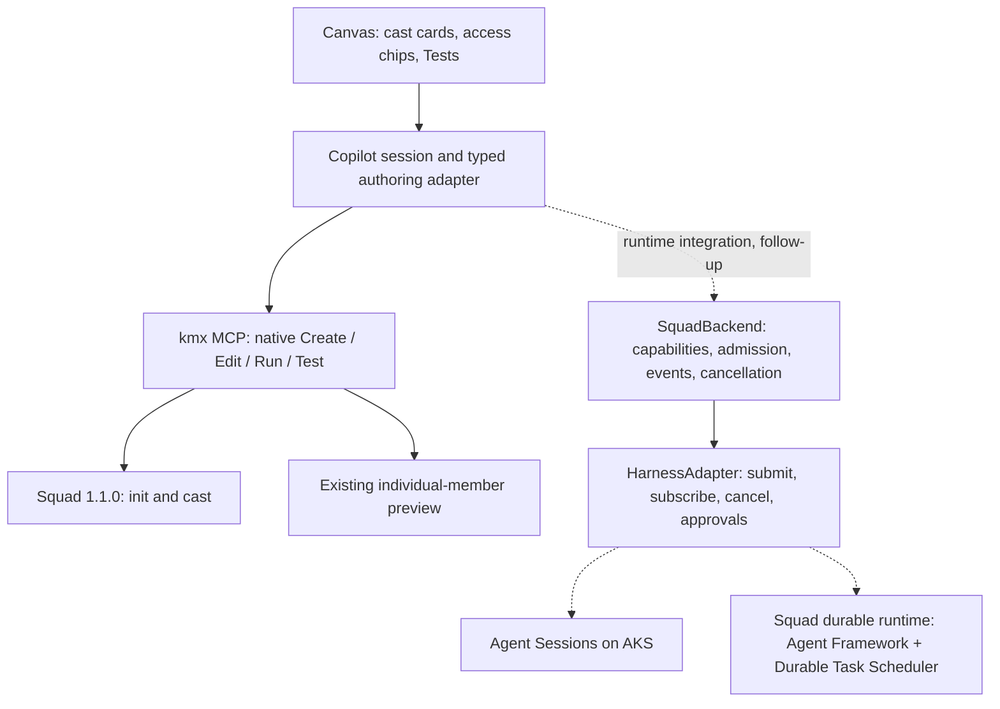

# Squad canvas: demo and architecture

The first vertical slice uses real native Squad 1.1.0 authoring through kmx MCP:
review a proposal, Create once, reopen the team, save the shared brief, edit a
member and run its tests. A new team starts with a blank goal. Enter the goal and
ask Copilot to propose roles, instructions and tests, then review the suggestion.
Proposals use the current model catalog; member previews use the configured route.

New to Squad? Read [the illustrated code-flow guide](SQUAD-CODE-FLOW.md) for the
concepts, source ownership and function-by-function creation/edit/test walkthrough.

## Architecture after maintainer feedback



The upstream experimental interfaces are defined in
[Squad backend/types.ts](https://github.com/bradygaster/squad/blob/b1fc9a2767993fcbcba51cade077c47a58278700/packages/squad-sdk/src/backend/types.ts).
The canvas's native authoring projection is not an implementation of that
conversation API. Integrate the real contract rather than inventing a matching
name for the existing preview operations. Runtime-specific logic stays out of
the renderer. Negotiated capabilities control available actions; access chips
must describe actual host enforcement. The current chip describes tool-free
native previews, which kmx enforces.

Tests are the quick inner-loop checks. Waza is the deeper package-digest evaluation
integration. Later recovery must distinguish journal replay from uncertain tool
or sandbox calls requiring fencing/approval; never replay an uncertain Create.

## Open in Copilot

Package a development plugin with a current kmx binary and a qualified standalone
Squad 1.1.0 launcher using `package.py` as described in [README.md](README.md).
Before installing, append `"--provider", "copilot"` to the `kmx-agent-builder`
server's `args` in the generated `mcp.json`, alongside the existing root and Squad
launcher arguments. This is trusted MCP startup configuration, not a `package.py`
flag. Use an existing supported GitHub sign-in as described in [README.md](README.md#agent-paths-and-real-tools).
The provider selection makes `kmx://models` available for proposal generation and
the model picker; the root-bound package default does not register that resource.
Install the configured directory, open its selected project in the Copilot
app, and invoke `/squad-view`. The canvas can also be opened through the built-in
opener with `canvasId: kmx-squad-view`, provider
`plugin:kmx-agent-builder:agent-view`, stable instance ID `kmx-squad`, and input `{}`.

For a chat-generated proposal, the opener accepts `input.proposal` with `brief`,
`lead` and `specialists`. Every member contains `memberId`, `role`, `displayRole`,
`taskInstructions`, `model` and `tests` (the existing ID/input/assertions objects).
The Lead uses role `lead` and display role `Lead / Architect`. Opening has no
creation effects. The canvas validates and submits only on Create squad.

## Browser rehearsal with real MCP

This checkout helper opens an already-created team. Create the team in the Copilot
app first; the helper refuses a fresh project without writing native state.
Proposal generation and Suggest tests require the real Copilot chat session.

```sh
node plugins/tests/copilot/squad-demo.mjs /absolute/kmx /absolute/saved-team /absolute/squad copilot
```

The final `copilot` argument selects hosted-model previews; omitting it retains
the helper's tool-free fake-route setup. The helper forwards real
native progress notifications and connection-scoped cancellation; it never
implements model execution itself.

This checkout helper forwards JSON-RPC to the real engine and displays its URL.
It supplies neither a fake MCP server nor a second preview runner. Browser
rehearsal is supplementary to the issue's required real Copilot-app screenshot.

### Five-minute Copilot-app demo

If the team already exists in the configured project, start at step 4 with the
saved team. Create does not replace an existing roster or reset the demo.

1. Open the Squad canvas, enter your goal and choose **Ask Copilot to propose**.
2. Expand a suggested role and test to inspect its input and checks. Choose
   **Use suggested team**, then review or edit the draft's roles and instructions.
3. Click **Create squad**. Show per-member native authoring outcomes.
4. Open a member and press Enter to run its tests. Show the actual results.
5. If a check fails, inspect the answer and improve the instructions. Keep the
   test unchanged and press Enter to evaluate the revised instructions.
6. Open one test and run it alone. Explain that a selected pass remains partial.
7. Return to Squad, update/save the shared brief, and reopen a member to show its
   previous result is stale. Refresh/reopen the team from native state.

While a real test is running, show the case counts, then type a new prompt edit
or click Stop tests. The old invocation is cancelled without aborting chat;
completed rows remain partial and the new draft survives. Enter after it stops
explicitly starts the next save/test. A test awaiting approval in Copilot chat
shows that state; it is not yet cancellable through the native active-run control.
Typing back to the previous prompt while a newer version is running also remains
an unsaved draft until the acknowledged source can be compared.

The generated response returns to the same canvas as a reviewable offer. Use suggested team
accepts it; Keep my draft preserves current work. Suggest changes follows the same
review flow, with no native writes until Create squad.
Suggestions show collapsed role cards with responsibility previews and test counts.
Expand a member, then a named test, to read its input and pass checks. Full
instructions are separately expandable; the existing draft stays under Your
current draft until the suggestion is accepted.
Creation with acknowledged effects retires any pending suggestion. A refusal
before effects keeps the draft and suggestion available for review.

The shared brief is saved in `.squad/kmx-brief.md` using revision-checked source
publication. Preview envelopes carry both member and brief revisions. Real model
routes receive native instructions plus the shared brief.

The canvas sends the displayed member and brief revisions with Run/Test. Native
execution checks both before preview, including after a tool approval delay. Older
native callers may omit both; supplying only one refuses. Background reads refresh
the active member, mark changed results out of date and preserve unsaved drafts.
Confirmed brief saves remain acknowledged if the subsequent team read fails.
An invalid or unreadable shared brief refuses native operations. The brief must
be nonempty UTF-8 text, at most 16 KiB, without NUL bytes; repair or remove
`.squad/kmx-brief.md` manually and refresh. Failed native reads preserve drafts and
historical results while removing current-pass status. Valid reads restore editing;
an explicit new preview establishes a current result.
If a pure Run/Test reply is lost or malformed, reload the member explicitly before
starting a new preview. The previous request may still finish; no retry is automatic.
Unconfirmed Create/Edit effects retain write protection, including a save followed
by an unconfirmed preview.
The native **Save model** action changes the charter's Preferred value; it is not
the canonical canvas's memory-only model override. Cached member controls follow
the same accepted snapshot as the editor. Existing members with no tests can open
and add their first test; removing the last test saves without running a preview.

## Remaining work

The native authoring adapter supports generated proposals, per-case progress
and request-scoped Test cancellation. Actual SquadBackend/HarnessAdapter runtime
integration, retained history and Waza integration remain follow-up work. Before
shipping, complete real app visual approval and broader cross-platform/security
qualification. Existing successful native creation can have partial brief-save
effects; inspect them, never repeat Create automatically.
