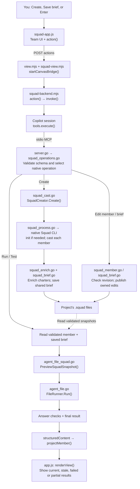
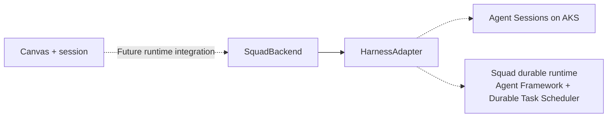

# How the Squad canvas works

This guide explains the native Squad authoring canvas and its code flow. Runtime
integration through upstream SquadBackend/HarnessAdapter is a later stage.

## 1. Start with three ideas

**Squad defines the team. Canvas is the workbench. kmx connects them and tests
individual members.**

Each team member needs a job description. In this implementation, those descriptions
are files called **charters**. A charter describes a member's identity, role,
responsibilities and other instructions.

Creating a squad prepares these definitions and native team records. It does not
start a group of background developers implementing your application. Testing a
member is a separate request that supplies its instructions and a test input to
the configured preview runner.

### Vocabulary

| Term | Plain-English meaning |
|---|---|
| Squad | A team of named agent definitions, with native roster and casting metadata |
| Member | One role in the team |
| Charter | The Markdown document at `.squad/agents/<member>/charter.md` describing that member |
| Init | Set up native Squad files in the project |
| Cast | Register a member with its ID and role and generate its native charter |
| Enrich | Add kmx-owned task instructions, model preference and tests to the native charter |
| Shared brief | One saved statement of the whole team's goal |
| Model | The engine producing a member's answer through the configured route |
| Test / example | An authored input plus checks on the answer |
| Revision | A fingerprint of saved bytes identifying exactly what was tested or edited |
| MCP | Model Context Protocol: the typed interface for tools and resources |
| Harness | The execution machinery that runs model turns |

The UI says **Tests**, while native storage still uses the **Examples** section.
These are two labels for the same saved quick checks in this slice.

## 2. The main code-flow diagram



The arrows show execution order. They do not mean that every box is a separate
server. Most are functions inside the extension process or kmx process.

## 3. Area-by-area explanation

### A. The team screen: what you interact with

Files: [squad-app.js](com.github.copilot/extensions/agent-view/squad-app.js),
[squad.html](com.github.copilot/extensions/agent-view/squad.html),
[squad.css](com.github.copilot/extensions/agent-view/squad.css).

`overview()` chooses between a proposed team and an already-created team.
`renderProposal()` draws editable role cards. `renderTeam()` draws saved members.
`openMember()` opens a member in the shared editor.

Editing a proposed card changes a JavaScript draft. Clicking **Create squad**
sends that reviewed draft to the extension. Browser code does not launch the
Squad executable or directly write the project files.

There are two ways to supply a proposal:

- **Ask Copilot to propose** sends the user's goal to the current Copilot session.
  The goal starts empty; proposal generation requires nonblank authored input.
- **Copilot chat** can prepare a proposal and pass it as `input.proposal` when
  opening the canvas. The canvas validates it; it does not invent the proposal.

### B. The extension and local bridge: connecting the screen to its session

Files: [extension.mjs](com.github.copilot/extensions/agent-view/extension.mjs),
[squad-view.mjs](com.github.copilot/extensions/agent-view/squad-view.mjs),
[view.mjs](com.github.copilot/extensions/agent-view/view.mjs).

`extension.mjs` registers the `kmx-squad-view` canvas and `/squad-view` command.
`createSquadViewController()` manages canvas instances. Its `open()` calls
`startSquadBridge()`, which creates the native adapter and reads the team before
returning the canvas URL.

`startCanvasBridge()` serves the HTML/CSS/JavaScript over a private localhost URL:

- `GET view.json` reads the team and optional proposal.
- `POST actions` submits a declared UI interaction.

The URL has a random token, and requests have host, origin and size checks. The
bridge's purpose is to connect this screen to its existing Copilot session.

### C. The JavaScript native adapter: translating UI intent

File: [squad-backend.mjs](com.github.copilot/extensions/agent-view/squad-backend.mjs).

`createNativeSquadBackend(session)` provides three operations to the canvas:
`team()`, `member(id)` and `action(input)`.

Important helpers:

- `validateProposal()` validates IDs, the required Lead, specialist count,
  instructions, models and tests. It serializes test objects into the fenced YAML
  expected by native MCP creation.
- `invoke()` finds the existing kmx tool and calls it through the Copilot session.
  If the session has not initialized its tools yet, it calls
  `initializeAndValidate()` first. This fixed the cold-session app error.
- `projectMember()` converts a native member resource into the shape expected by
  the shared editor. It compares member and brief revisions with the last result.
- `observations` is an in-memory map of returned member results. It is not saved
  test history and disappears when this adapter instance ends.

This is an authoring adapter named `createNativeSquadBackend`. It does not
implement the experimental upstream `SquadBackend` conversation interface.

### D. Copilot session and MCP: delivering the request

Files: [mcp_commands.go](../../cmd/kmx/mcp_commands.go),
[server.go](../../internal/kmx/mcp/server.go),
[squad_operations.go](../../internal/kmx/mcp/squad_operations.go).

The extension calls `session.rpc.tools.execute()`. Copilot applies its tool
permission handling and delivers the request to the configured kmx MCP process.
The browser never receives model credentials or chooses another MCP server.

At startup, `mcp_commands.go` creates the optional native Squad adapter when the
standalone executable and release have been configured. It attaches the four
operations and the native resources. Startup does not create a team.

`NewServer()` checks the request schema and version. `WithSquadOperations()`
dispatches the native v2 requests:

| Request | Meaning |
|---|---|
| Create, target `squad-members` | Create the reviewed team |
| Edit, target `squad-member` | Save a member's owned fields |
| Edit, target `squad-brief` | Save the shared brief |
| Run, target `squad-member` | Preview a member, optionally with ad-hoc input |
| Test, target `squad-member` | Evaluate the member's saved tests |

An MCP resource is a read-only view rather than an action. For example,
`kmx://squad` returns team state; reading it does not create or test anything.

### E. Native Squad: creating the real team definitions

Files: [squad_cast.go](../../internal/kmx/mcp/squad_cast.go),
[squad_process.go](../../internal/kmx/mcp/squad_process.go),
[squad_enrich.go](../../internal/kmx/mcp/squad_enrich.go).

`SquadCreator.Create()` performs this sequence:

1. Validate the entire proposed team and shared brief before native effects.
2. Check the selected project and its existing native state.
3. If setup is absent, invoke native Squad `init` with fixed setup flags.
4. For each proposed member, call native `cast` with the reviewed ID and role.
5. Verify that the member was registered, then call `enrichSquad()` to add the
   kmx-owned fields to the generated charter.
6. Save the shared brief through the owned brief adapter.
7. Return setup, member and brief-publication outcomes.

Native Squad owns the registration records and native charter sections. kmx
uses the native command instead of inventing those records itself.

Creation can stop partway through. If three members were created before a later
failure, those three still exist. The response describes what happened; the
canvas does not automatically repeat Create or roll back native metadata.

### F. Source storage: remembering the team and protecting edits

Files: [squad_resource.go](../../internal/kmx/mcp/squad_resource.go),
[squad_member.go](../../internal/kmx/mcp/squad_member.go),
[squad_brief.go](../../internal/kmx/mcp/squad_brief.go),
[files.go](../../internal/kmx/mcp/files.go).

```text
demo-project/
└── .squad/
    ├── team.md                     Native roster
    ├── routing.md                  Native routing metadata
    ├── casting/                    Native registration records
    ├── kmx-brief.md                 Shared goal saved by kmx
    └── agents/
        ├── lead/charter.md
        ├── offline-storage/charter.md
        ├── sync/charter.md
        └── quality/charter.md
```

Each member charter contains both owners' material:

| Squad-owned | kmx-owned |
|---|---|
| Identity, role, boundaries, collaboration and native metadata | Task Instructions, Preferred model value and Examples/tests |

`Member()` reconstructs and validates a member from native casting records, the
roster and its charter. `EditMember()` replaces only the owned fields.
`EditBrief()` saves only `.squad/kmx-brief.md`.

Edits carry `expectedRevision`: "save only if the file is still the version I
read." The file helpers check the source and publish a replacement through a
temporary file and rename. A conflicting edit is refused rather than silently
overwritten. This revision is a fingerprint, not a version-history menu.

### G. Preview and tests: where answers and verdicts come from

Files: [agent_file_squad.go](../../internal/kmx/app/agent_file_squad.go),
[agent_file.go](../../internal/kmx/app/agent_file.go),
[app.js](com.github.copilot/extensions/agent-view/app.js).

The native Run/Test handler reads the validated member and saved brief.
`PreviewSquadSnapshot()` re-parses the exact charter and constructs the input for
the shared preview engine. Its effective instructions contain the shared brief
and native instructions, which already include the member's task instructions.
Task instructions are included once. Examples are kept outside the prompt.

`previewAgentSnapshot()` selects the requested cases and calls `FileRunner.Run()`.
The configured route then produces answers and evaluates checks:

- Local/fake preview uses the existing embedded Sessions path and private journal.
- Explicit Copilot routes also use embedded Sessions, including journaled judge
  samples and provider-owned content checks before journaling.
- Literal checks such as `contains` inspect the answer directly.
- Existing `llmJudge` checks use the configured model-based judge path.

The final safe result travels back as `structuredContent`. The adapter verifies
member identity, source revision, brief revision and selected cases, stores the
observation, then calls `projectMember()`. The shared `renderView()` displays it.

The current native canvas shows correlated per-case progress while awaiting the
final result. Typing during an active test or choosing Stop tests cancels that
member invocation through native MCP. The final response establishes whether it
stopped; partial progress alone never establishes a full pass. Newer prompt edits
remain drafts rather than being replaced by the earlier save/test response.

## 4. Follow one test from beginning to end

1. You press Enter in the member's prompt editor.
2. `app.js` requests `save-and-test`. `squad-app.js` wraps it as a member action.
3. The adapter checks the current resource. If owned fields changed, it calls
   native Edit and confirms the returned revision by reading the member again.
4. It calls native Test. The Go handler reads the member and brief and invokes
   the preview engine.
5. The configured model answers each selected input. The existing assertion
   evaluator checks those answers against the authored expectations.
6. The final result reaches the canvas, which shows each test's actual outcome.
7. If a check fails, you can revise the instructions and press Enter again.
   A new source revision is saved and tested against the same expectations.

These are checks of individual member responses. Real model routes receive the
combined shared and native instructions; results do not establish team execution.

## 5. Why the shared brief has its own revision

Suppose a result tested member revision **M1** with brief revision **B1**. Later,
you change the shared brief.

The member file can remain M1, but the brief is now B2. On the next member read,
`projectMember()` compares the pair and marks the M1/B1 result stale. This prevents
an old pass from appearing to validate the new shared context.
The canvas polls the active member and applies these observations without dropping
drafts. It also sends the displayed M/B pair to native Run/Test, which refuses a
mismatch before execution and then previews those exact loaded snapshots.

Saving the brief does not run tests automatically. A selected test passing also
does not establish a full member pass. Full-member results remain distinct from
team execution or package-level evaluation.

## 6. Where SquadBackend and HarnessAdapter fit later



Think of **SquadBackend** as the team conversation's service interface: it
negotiates capabilities, admits work, returns events/transcripts, and handles
cancellation and approvals.

Think of **HarnessAdapter** as the connector to the machinery that executes that
work. Its upstream methods include submit, subscribe, cancel and respondApproval.
Its delivery rules include stable operation IDs and protection against obsolete
workers producing duplicate effects.

Those experimental upstream interfaces let a UI work with different runtimes.
Our current native-authoring adapter has not wired them in. Access chips must
reflect real host enforcement, and future recovery must distinguish reading old
journal events from reissuing a tool or sandbox action.

**Waza** is the deeper evaluation integration tied to a package digest. The quick
Tests rows in this demo are a separate inner-loop capability.

## 7. How to read the code yourself

Start with these five stops rather than reading the entire repository:

1. `squad-app.js`: find the Create button and `openMember()`.
2. `squad-backend.mjs`: follow `action()` and `invoke()`.
3. `squad_operations.go`: see how a native request selects the Go operation.
4. `squad_cast.go`: follow team creation; or `squad_member.go` for an edit.
5. `agent_file_squad.go`: see the member/brief snapshot handed to preview.

See [the demo and architecture guide](SQUAD-CANVAS.md) for the run instructions.
